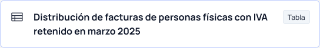

# Conversation Response · Preview · revisión documental

24 de noviembre de 2026. Solicitud: «Modifiqué este componente, documenta el cambio», [222:111](https://www.figma.com/design/yZsIpXywybsPDytjolwcP4/AI-Blueheart-DS?node-id=222-111). El auxiliar `.Conversation / Preview` conserva su familia y versión 1.0.0.

## Cambio documentado

Title y Badge «Tabla» comparten la fila horizontal Preview details. Title usa Fill/Hug, Badge Hug/Hug y separación tokenizada de 8 px. La tarjeta conserva padding y gap exterior de 16, icono de 24, radio de 8 y borde de 1 incluido en layout. La referencia actual mide 544×82; el alto es Hug y no se fija como constante de producto. BENI y NAVI heredan el ajuste.

[Enmienda vigente](../../../specs/components/conversation-response.preview-layout.amendment.v1.0.0.md) · [Datos de layout](../../../specs/data/conversation-response.preview-layout.v1.0.0.json) · [QA documental](../../../qa/contracts/conversation-response.preview-layout.v1.0.0.review.md).

## Evidencia y comprobaciones

[Contrato observado MD](../../../sources/figma-snapshots/conversation-preview-2026-11-24/component-contract.md) y [YAML determinista](../../../sources/figma-snapshots/conversation-preview-2026-11-24/component-contract.yaml), desde el mismo modelo normalizado; [snapshot crudo](../../../sources/figma-snapshots/conversation-preview-2026-11-24/raw-evidence.json), captura y [digests](../../../sources/figma-snapshots/conversation-preview-2026-11-24/validation.json) conservados juntos.

- 11 nodos, incluidas instancias invisibles y sus vectores; sin pendientes ni truncamiento.
- Cuatro instancias resueltas a tres componentes: Badge local y dos iconos remotos activos. Versión y archivo externo no expuestos por MCP; se registra la limitación.
- 29 variables directamente usadas y 44 dependencias transitivas; 73 locales, un estilo nombrado y 116 cadenas component → semantic → primitives por cuatro modos. [Cotejo](evidence-review.json) y [cadenas](resolved-chains.json).
- Ruby/Psych valida YAML→JSON idéntico al modelo y las 17 secciones requeridas están presentes. El generador queda en [build-contract.py](build-contract.py).
- `python3 scripts/generate.py` en implementations/web: 51 familias cubiertas; tres derivados documentales actualizados. Incluye la enmienda y la diferencia de web en la ficha, su copia pública y los metadatos de catálogo.
- `scripts/ds check --docs-only --report output/qa/conversation-preview-2026-11-24/documentation-check.json`: PASS; sintaxis, referencias y digests verificados. [Resultado](documentation-check.json).
- [Preservación](scope-preservation.json): datos base, snapshot histórico, TSX y CSS idénticos a HEAD. [Pins de fuentes](source-pins.json). Cero escrituras Figma y cero modificaciones de código de aplicación.

La fuente histórica 218:1228 muestra detalles verticales y corresponde al origen remoto, no a una captura inmediatamente anterior del local 222:111. Se conserva esa diferencia para evitar un before/after ficticio. Las descripciones actuales siguen explicando el propósito y no se modificaron en Figma.

## Límite de implementación

**Web STALE_FOR_PREVIEW_LAYOUT:** ConversationResponsePreview todavía apila título y Badge con flex-col. Está registrado en contrato, QA y ficha técnica; no se ejecutó implementación web en este encargo documental. No se renovó el QA histórico ni se ejecutaron navegador, redimensionamientos, nuevos gestos o certificación WCAG. No se creó una familia pública ni nuevos tokens.

El cierre local del catálogo, índice de consumo y Graphify se registra por separado en [el recibo del lote](../../closures/2026-11-24-conversation-preview-layout.json). Solo su estado y hashes finales acreditan vigencia. Las contribuciones intactas del corte Tabs se reutilizan con procedencia; sus archivos y paquetes se conservan. Los lanzadores de consumo mantienen su versión y las entregas autocontenidas históricas no se reempaquetaron ni instalaron por esta solicitud. Sin commit, push o publicación Figma. Uso de tokens de sesión y cuenta: UNAVAILABLE.

## Resultado final del cierre

`scripts/ds close --run 2026-11-24-conversation-preview-layout`: **COMPLETE_LOCAL**, nueve fases PASS, 37.89 s en la invocación de cierre. Graphify CURRENT: 1,478 archivos, 6,728 nodos, 13,390 relaciones; 162/162 dependencias declaradas verificadas. Catálogo local CURRENT: 1,435 archivos y 52 familias; no se añade una familia pública para el auxiliar. Lanzadores 1.0.9 con operación UNCHANGED, sin instalación. El primer paso preparó únicamente el delta semántico de nueve documentos y una captura; se reutilizaron 296 contribuciones semánticas intactas. [Semántica documental](../../../graphify-out/runs/2026-11-24-conversation-preview-layout/chunk-00.json) y [visual](../../../graphify-out/runs/2026-11-24-conversation-preview-layout/chunk-01.json) separadas.

[Integridad final](final-integrity.json): hashes de todos los outputs del grafo cotejados con ds-closure, manifiesto de catálogo verificado y rutas directas de la enmienda al contrato base y al YAML observacional. Se cotejaron también los hashes de seis fuentes del alcance en catálogo y su asociación a la familia original. [Consulta amplia](graph-query.txt) con vocabulario real [registrado](graph-query-selection.json), limitada a 1,200 tokens; su truncamiento no acredita cobertura por sí solo. La comprobación del cambio usa las rutas por ID del informe de integridad y la [consulta de camino acotada por IDs, sin dirección](graph-path-exact.txt), que encuentra la referencia directa. El intento anterior por etiquetas [ambiguas](graph-path.txt) se conserva sin tratarlo como validación. DS digest `f2178fc12bf87cbd235c473f36e08f812428cecafd73ea593eac7ea05511d93a`; SHA-256 del manifiesto de catálogo `de4eb41e9e9802d688c921c326b133d83768a00e36128f214a2eb69b304168dc`.

[Lectura final Figma](final-figma-readback.json), 2026-11-24T15:40:51.186Z: raíz, fila, título, Badge y consumidores BENI/NAVI conservan los valores documentados; [94 campos comparados, cero diferencias](final-figma-comparison.json). Se mantuvo solo lectura. El PASS del cierre local y de esta comparación no elimina la diferencia web declarada ni sustituye pruebas de responsive o accesibilidad no ejecutadas.
